# LOOKSMATTER — Commerce Backend

**The backend of a full-stack fashion e-commerce platform, built as microservices: an API gateway, a core service (accounts, catalog, carts, support) and an order service (checkout, order lifecycle, UPI payments), each with its own database.**


LOOKSMATTER is split across two repositories:

| Repository | Role |
| --- | --- |
| **looksmatter-backend** (this repo) | API gateway + services: business rules, persistence, payments, authorization |
| [**looksmatter_ui**](https://github.com/abuiron/looksmatter_ui) | React + TypeScript storefront and admin workspace |

The backend is the source of truth. The browser can show prices and cart previews, but the services decide what an order contains, what it costs, and who is allowed to change it.

> 📘 **[How and why this backend was split into microservices →](docs/MICROSERVICES.md)**
> A complete guide: microservice fundamentals, how to prepare before splitting, every change made here, data migration, testing and deployment.

---

## Contents

- [What I built](#what-i-built)
- [Architecture](#architecture)
- [Data model](#data-model)
- [Core flows](#core-flows)
  - [Authentication and authorization](#1-authentication-and-authorization)
  - [Size-aware, self-healing carts](#2-size-aware-self-healing-carts)
  - [Checkout across services](#3-checkout-across-services)
  - [UPI payments](#4-upi-payments)
  - [Order and payment lifecycles](#5-order-and-payment-lifecycles)
  - [Store operations](#6-store-operations)
  - [Customer support reports](#7-customer-support-reports)
- [API reference](#api-reference)
- [Getting started](#getting-started)
- [Configuration](#configuration)
- [Project structure](#project-structure)
- [Testing](#testing)
- [Engineering conventions](#engineering-conventions)
- [Known limitations and roadmap](#known-limitations-and-roadmap)

---

## What I built

### Architecture

| Capability | How it works | Why it matters |
| --- | --- | --- |
| **API gateway** | One public entry point: routing table, CORS, request ids, aggregate health, clean `502`/`504` errors | The storefront and payment provider keep using one URL; services stay private |
| **Database per service** | core-service and order-service each own their database; no cross-service `populate` | Services can change and deploy independently |
| **Internal service API** | Four small `/internal` endpoints with a shared key, timeouts, and retries only where repeating is safe | A slow or failing service can't hang its callers or double-apply a change |
| **Checkout across services** | order-service orchestrates: priced bag from core → order → remove exactly the ordered lines | Every failure mode is handled and tested; no order is created when core is down |
| **Snapshots + API composition** | Orders keep a customer snapshot; reports keep an order snapshot and add live status in one batch call | Admin screens keep working and stay fast without cross-database joins |
| **Fault isolation** | When order-service is down, the catalog, carts and support desk keep working (tested) | One failing service doesn't take down the store |
| **Safe data migration** | Dry run by default, insert-only, re-runnable, self-verifying | Existing orders move to the new database with a rollback path |
| **Containers** | Dockerfiles per service, non-root, health checks; Compose publishes only the gateway | The whole system starts with one command, isolated the way production should be |
| **End-to-end tests** | 21 journeys through the gateway against real services and a mock UPI provider | Covers checkout, payments, outages and the migration |

### Commerce

| Capability | How it works | Why it matters |
| --- | --- | --- |
| **Size-aware carts** | Cart lines are keyed by `product + size` | One product can be bought in S and M as separate lines |
| **Self-healing references** | Cart, favorites, and history ids are resolved against the live catalog; dead ids are pruned on read | A deleted product never crashes a page or checkout |
| **Server-priced checkout and payments** | Order totals come from server-side prices, and payments are always started for the stored order total | A modified browser payload cannot change what the shopper pays |
| **Order snapshots** | Each order stores name, image, price, size, quantity and customer | Editing a product or profile later does not rewrite purchase history |
| **Recoverable checkout conflicts** | Missing products produce `409 CART_ITEMS_UNAVAILABLE`, and the cart is cleaned | The UI can show the shopper an updated bag instead of failing |
| **Encrypted UPI gateway adapter** | AES-256-CBC payloads + HMAC-SHA256 checksums; webhook **and** status-check paths | Payments are confirmed even if one notification path is missed |
| **Payment state machine** | Provider events only apply valid moves (`pending → paid → refunded`, never back) | Retried and out-of-order webhooks can't undo a payment or a shipment |
| **Separate payment and fulfilment state** | `paymentStatus` and `status` evolve independently | "Paid but not shipped" and "COD delivered, unpaid" are both representable |
| **Bulk catalog import** | Validates each row, inserts good rows with `ordered: false`, reports bad rows by number | One malformed spreadsheet row doesn't block 500 good ones |
| **Cascade on product delete** | Removes the product from every user's cart, favorites, and recently viewed | No orphaned references are left behind |
| **Two-phase order removal** | Admin flags an order with a reason; only the customer can then delete it permanently | Customers are told why an order was withdrawn |
| **Support desk** | Order- and payment-issue reports with screenshots, admin notes, and status stats | Post-purchase problems are tracked in the app, not in email |

---

## Architecture

### System overview

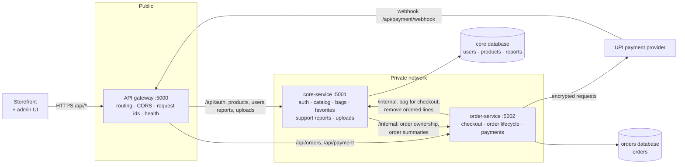

| Component | Port | Responsibility | Database |
| --- | --- | --- | --- |
| **gateway** | 5000 (public) | Routes `/api/*` to the owning service; CORS; `X-Request-Id`; `/health` for the whole system | — |
| **core-service** | 5001 | Accounts and JWTs, catalog, bags, favorites, recently viewed, support reports, image uploads | `looksmatter` |
| **order-service** | 5002 | Checkout, order lifecycle, UPI payments and webhooks, customer order statistics | `looksmatter_orders` |

The public API is **exactly the same** as before the split: the storefront only knows the gateway's URL. Each service is a complete Node.js app with its own `package.json`, `.env`, `Dockerfile` and database, so it can be deployed on its own.

### A request's path

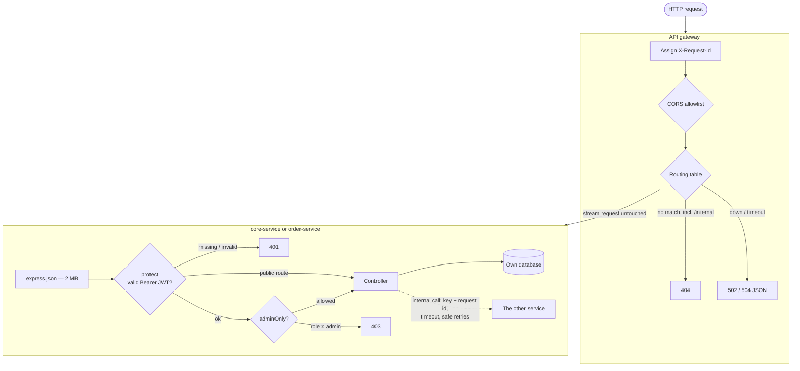

- **The gateway never parses bodies.** It streams them, so JSON and multipart uploads arrive at the service untouched.
- **Every service verifies the JWT itself** with the shared secret, so order-service authenticates requests even when core-service is down.
- **Each service waits for its own database before listening**, fails fast on missing configuration, and shuts down cleanly on `SIGINT`/`SIGTERM`.

### Service-to-service API

| Endpoint | Owner → caller | Purpose |
| --- | --- | --- |
| `POST /internal/users/:userId/checkout-cart` | core → order | The bag priced against the live catalog, plus customer name/email; prunes vanished products |
| `POST /internal/users/:userId/cart/remove-lines` | core → order | Remove exactly the ordered `product + size` lines (idempotent) |
| `GET /internal/orders/:id?userId=` | order → core | One order with items, optionally only if that user placed it |
| `POST /internal/orders/summaries` | order → core | Many order summaries in one round trip |

`/internal` is never routed by the gateway and requires a shared `INTERNAL_API_KEY` (constant-time comparison). See [the guide](docs/MICROSERVICES.md#43-services-talking-to-each-other-the-internal-api) for timeouts, retries and why the helpers are duplicated rather than shared.

---

## Data model

Two databases, each owned by one service. Ids that point into the other database are plain ObjectIds: there is no `populate` across services.

**core database** (core-service)

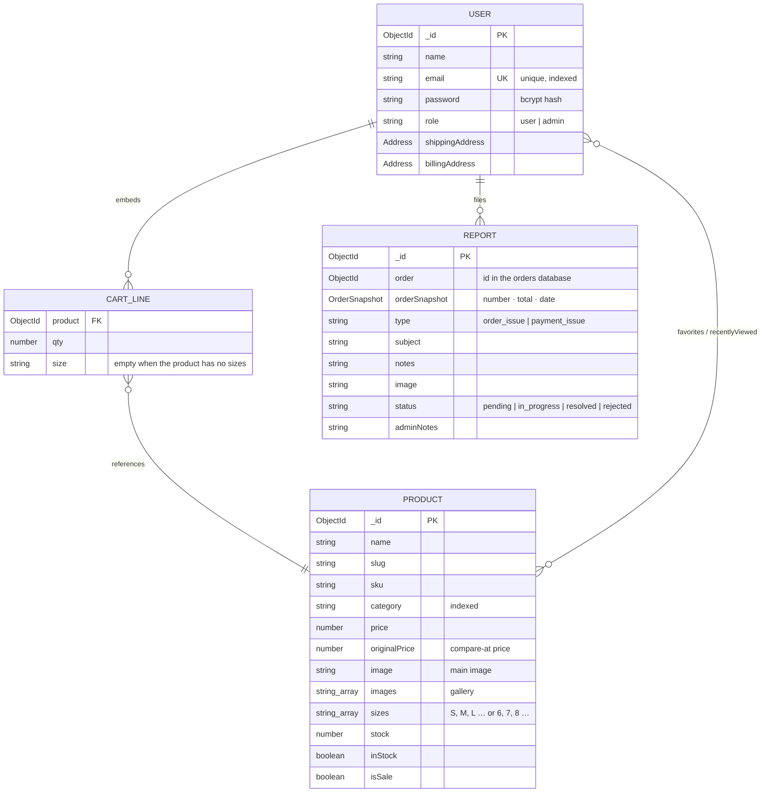

**orders database** (order-service)

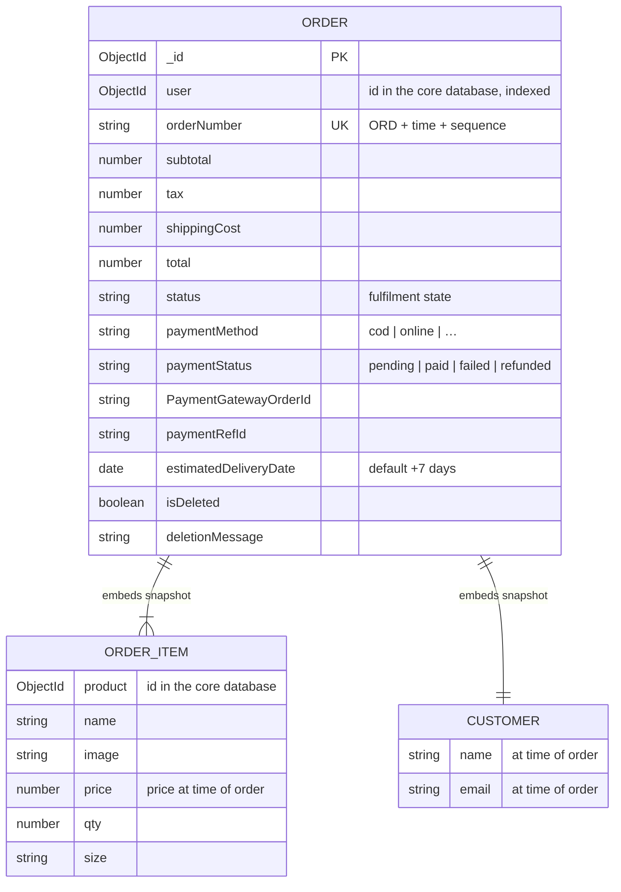

**Embed, reference or snapshot?**

- **Cart lines are embedded in the user.** A cart is always read and written with its owner.
- **Order items and the customer are snapshots.** Name, image, price and the customer's details are copied when the order is placed, so history stays accurate after catalog or profile edits. It also means admin screens need no cross-service call.
- **Reports keep an order snapshot** of the fields that never change (number, total, date), and responses add the live status from order-service.

**Indexes:** `User.email` (unique), `Product.category`, `Order.orderNumber` (unique), `Order.user`, `Report { user, status }`, `Report.order`.

---

## Core flows

### 1. Authentication and authorization

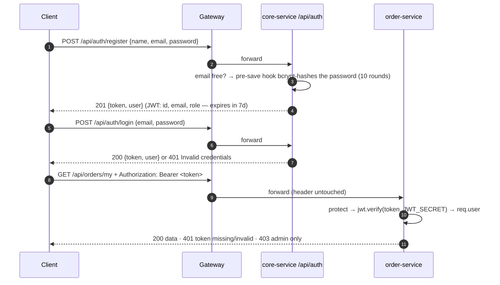

- core-service **issues** tokens; every service **verifies** them with the shared `JWT_SECRET`. No service calls another just to authenticate.
- Login returns the same message for an unknown email and a wrong password, so the endpoint can't be used to discover accounts.
- Password hashes are never returned. Profile queries use `.select('-password')`.
- **Password change** shares the profile route. When `PUT /api/users/me` includes `currentPassword` and `newPassword`, core-service verifies the current password and enforces an 8-character minimum before rehashing.

### 2. Size-aware, self-healing carts

A cart line is identified by **product id + size**, so adding "Oxford Shirt / M" twice increments one line, while "Oxford Shirt / L" becomes a second line.

Carts, favorites, and recently viewed lists store product ids. Those ids can go stale when an admin deletes or re-imports a product. Every read therefore resolves the ids against the live catalog through one shared helper (`services/core-service/src/utils/cart.js`):

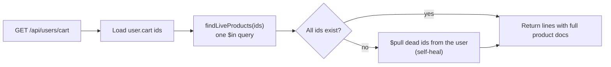

Writes are guarded as well. `addToCart` and `addFavorite` reject ids for products that don't exist. Quantities must be whole numbers ≥ 1. Add and remove are separate idempotent endpoints rather than a toggle, so a retried request can never flip state the wrong way.

### 3. Checkout across services

The bag and the catalog live in core-service; orders live in order-service. order-service **orchestrates** checkout:

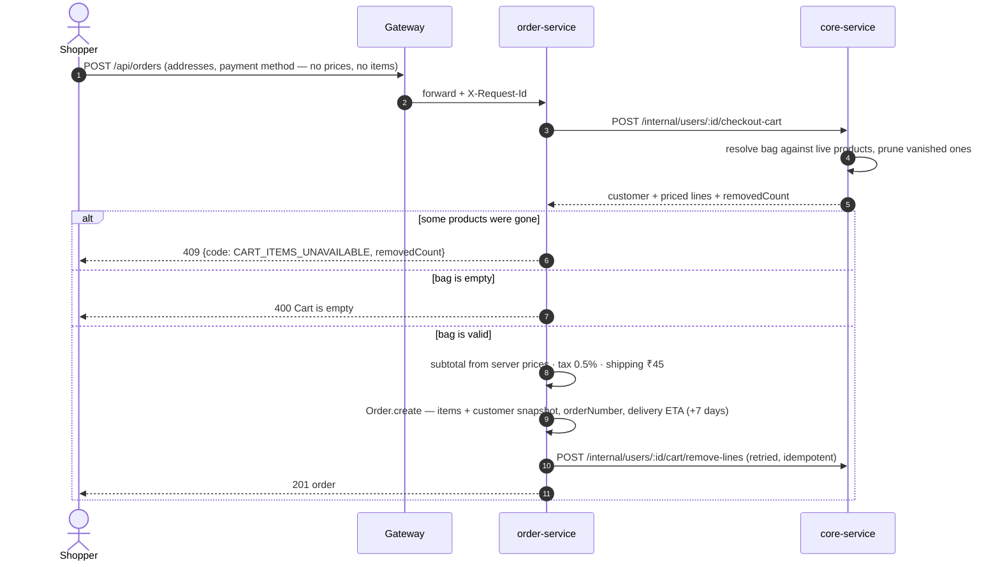

The request body has **no say in what is purchased or what it costs**. Items come from the server-side bag, and prices come from the product collection.

**Failure handling** (each case is covered by the end-to-end tests):

| What fails | Result |
| --- | --- |
| core-service unreachable before the order is written | `503` "Checkout is temporarily unavailable" and **no order is created** |
| A product vanished | `409 CART_ITEMS_UNAVAILABLE`; core-service has already cleaned the bag |
| Removing the ordered lines fails after retries | `201`: the order stands; the leftover bag lines are logged with the request id (the storefront also clears the bag after checkout) |

Only the ordered `product + size` lines are removed, so an item added to the bag in another tab during checkout survives.

Error handling separates the two kinds of failure. Mongoose `ValidationError`/`CastError` become `400` with a useful message. Anything else is logged and returned as a generic `500`, so internal details are never shown to shoppers.

### 4. UPI payments

The payment adapter (`services/order-service/src/utils/paymentGateway.js`) wraps a UPI provider whose API exchanges **encrypted** payloads:

- **Encryption:** AES-256-CBC with a SHA-256-derived key and PKCS7 padding
- **Integrity:** HMAC-SHA256 checksum over the encrypted body
- **Credentials:** `client-id` and `secret-key` headers, held **only by order-service**

```mermaid
sequenceDiagram
    autonumber
    participant UI as Storefront
    participant API as order-service
    participant PSP as UPI provider
    participant DB as orders DB

    UI->>API: POST /api/payment/initiate {orderId, phone}
    API->>DB: load the order — must belong to the shopper and be unpaid
    API->>PSP: encrypted {merchant order id, amount = order.total} + checksum
    PSP-->>API: encrypted {txnRefId, paymentUrl}
    API->>DB: store PaymentGatewayOrderId, paymentRefId, qrCodeUrl
    API-->>UI: {paymentUrl, txnRefId}
    Note over UI: Desktop shows a QR code · mobile opens the UPI app

    par Provider webhook
        PSP->>API: POST /api/payment/webhook {encryptedData}
        API->>API: verify checksum if sent and decrypt references
        API->>PSP: query stored transaction and verify both ids and amount
        API->>DB: apply only if the move is valid (state machine)
        API-->>PSP: 200 on success; 503 if verification fails
    and Client polling
        loop every 5 s while the payment modal is open
            UI->>API: GET /api/orders/:id
        end
    end

    opt Shopper taps "Check status"
        UI->>API: POST /api/payment/status {orderData: {orderId}}
        API->>PSP: encrypted status query for the STORED transaction
        API->>DB: apply the answer through the same state machine
    end
```

**Integrity rules** enforced by order-service:

- A callback triggers a server-to-server status lookup. Its status and payer fields are never trusted. Both transaction identifiers and the amount must match the stored order before it can change. Verification failures leave the order unchanged and return 503; malformed callbacks return 400. Provider requests time out after eight seconds and do not follow redirects.

- The amount sent to the provider is always the stored `order.total`. Any `amount` in the request is ignored.
- Payments can only be started and checked for the shopper's **own** order; another user's order id gives `404`.
- Status checks query the provider with the transaction ids **stored at initiation**, not ids from the request body.
- There is no endpoint that lets a client set a payment status. (The monolith's `PUT /api/payment/update-order/:orderId` was removed during the split.)

**Status normalization.** Provider statuses are uppercased, stripped of underscores, and mapped to a small internal set:

| Provider status (normalized) | `paymentStatus` | Order `status` |
| --- | --- | --- |
| `SUCCESS` | `paid` | `pending` → `order confirmed` (later statuses are left alone) |
| `FAILED`, `FAILURE` | `failed` | unchanged |
| `TAMPERED` (amount mismatch) | `failed` | `cancelled` |
| `REFUNDED`, `CBREFUNDED` (chargeback) | `refunded` | unchanged |
| `INITIATED`, `PENDING`, `TRANSACTIONINPROGRESS`, `HOLD`, `ONHOLD` | `pending` | unchanged |
| anything else | unchanged — logged for investigation | unchanged |

Webhooks and status checks share one function (`utils/paymentStatus.js`), so both paths behave identically.

### 5. Order and payment lifecycles

Fulfilment (`status`) and money (`paymentStatus`) are separate fields, so each can be tracked independently.

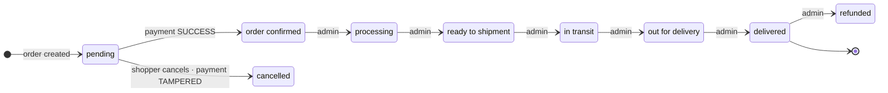

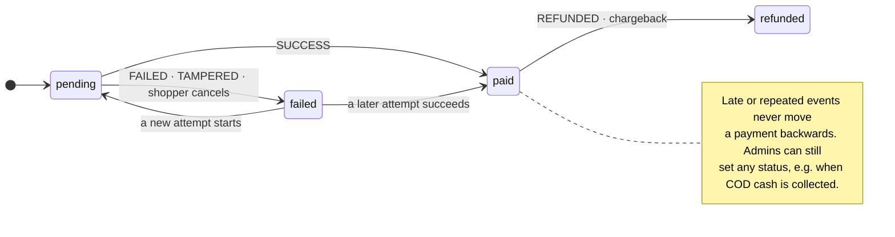

- A shopper can cancel **only while the payment is still `pending`**. Cancelling sets `status: cancelled` and `paymentStatus: failed`.
- Each order gets a human-readable **order number** (`ORD` + time component + sequence) and a default **estimated delivery date** 7 days out, both from a `pre('save')` hook. Admins can change the delivery date.

### 6. Store operations

**Bulk catalog import:** `POST /api/products/bulk`

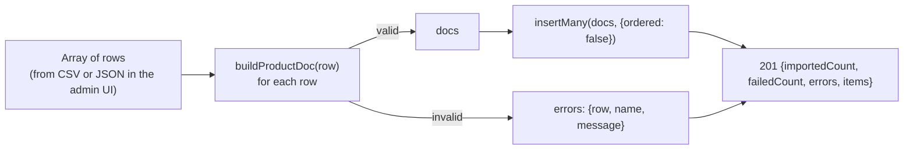

The normalizer is forgiving about input and strict about output. It is shared by single create, bulk import, and update.

- `"S, M, L"`, `"6|7|8"`, or `["S","M"]` → a deduplicated `sizes` array
- `"https://a.jpg, https://b.jpg"` → `image` (first URL) + `images` gallery. Commas inside a URL's query string (`?w=500,h=500`) are glued back together instead of splitting the URL.
- `"yes"`, `"In Stock"`, `"1"`, `true` → `inStock: true`
- Missing `slug` → generated from the name; missing `sku` → `CATEGORY-XXXX`
- `oldPrice` and `originalPrice` are kept in sync so the storefront strike-through price is always correct
- Required fields (`name`, `category`, `price`, `image`) are validated with a message that names exactly what is missing

**Partial updates:** `PUT /api/products/:id` only overwrites fields present in the request, so the admin form can send a subset. Explicit `false` values still apply.

**Product delete cascade:** deleting a product also `$pull`s it from every user's cart, favorites and recently viewed list.

**Two-phase order removal:**

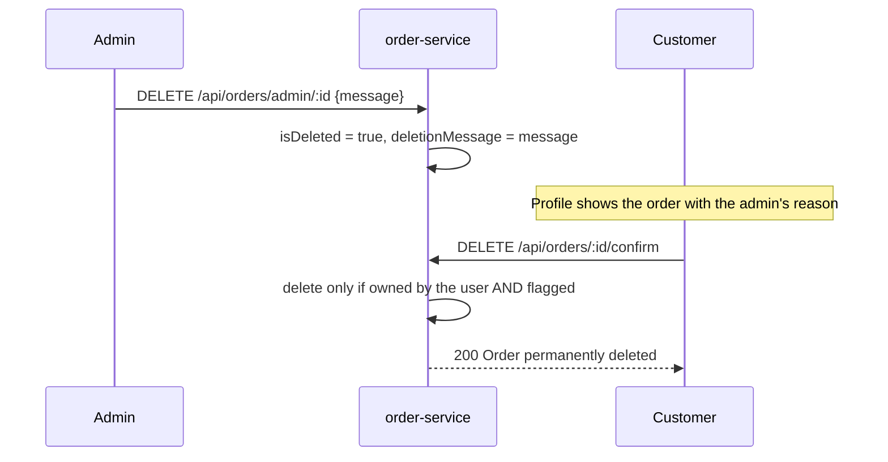

**Customer insights:** `GET /api/users/:id/orders` returns total, successful, pending and cancelled order counts and lifetime spend (paid orders only), plus the 10 most recent orders. It's served by order-service, which owns the data; the gateway maps the original URL to `/api/orders/admin/users/:id/stats`.

### 7. Customer support reports

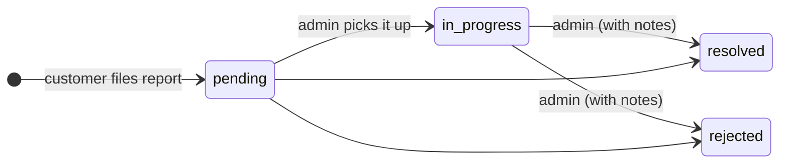

- Filing a report asks order-service whether the order belongs to the reporter. If order-service is unreachable, filing is refused with `503`: ownership can't be verified, so the request fails closed.
- Report lists show each order's number, total and **live** status, fetched from order-service in **one batch call** per list. If order-service is down, lists still answer from the stored snapshot (without the live status).
- Admins filter by status and type and see aggregate counts from `GET /api/reports/admin/stats`.
- `GET /api/reports/:id` is available to the report's owner and to admins.

---

## API reference

All routes go through the gateway and are prefixed with `/api`. Protected routes need `Authorization: Bearer <token>`.
🌐 public · 🔒 signed-in user · 🛡️ admin · 🔁 provider callback

### Auth — core-service

| Method | Path | Access | Description |
| --- | --- | --- | --- |
| POST | `/auth/register` | 🌐 | Create an account → `{ token, user }` |
| POST | `/auth/login` | 🌐 | Sign in → `{ token, user }` |
| GET | `/auth/me` | 🔒 | Current user (without password) |

### Catalog — core-service

| Method | Path | Access | Description |
| --- | --- | --- | --- |
| GET | `/products` | 🌐 | List/search. Query: `q`, `category`, `page`, `limit` (default 20, max 100, `0` = all) → `{ items, total, page, pages }` |
| GET | `/products/:id` | 🌐 | Single product (`404` for malformed or unknown ids) |
| POST | `/products` | 🛡️ | Create one product |
| POST | `/products/bulk` | 🛡️ | Bulk import, partial success → `{ importedCount, failedCount, errors, items }` |
| PUT | `/products/:id` | 🛡️ | Partial update |
| DELETE | `/products/:id` | 🛡️ | Delete + cascade cleanup from all users |

`q` matches case-insensitively against name, description, and tags.

### Profile, cart, favorites, history — core-service

| Method | Path | Access | Description |
| --- | --- | --- | --- |
| GET | `/users/me` | 🔒 | Profile with addresses |
| PUT | `/users/me` | 🔒 | Update name/addresses; add `currentPassword` + `newPassword` to change the password |
| GET | `/users/cart` | 🔒 | Cart lines with full products (stale ids pruned) |
| POST | `/users/cart` | 🔒 | Add `{ productId, qty, size }`; merges into an existing product+size line |
| PUT | `/users/cart/:productId` | 🔒 | Set quantity `{ qty, size }` |
| DELETE | `/users/cart/:productId?size=M` | 🔒 | Remove one line |
| DELETE | `/users/cart` | 🔒 | Clear the cart |
| GET | `/users/favorites` | 🔒 | Favorite products (stale ids pruned) |
| POST · DELETE | `/users/favorites/:productId` | 🔒 | Idempotent add / remove |
| GET | `/users/recently` | 🔒 | Recently viewed products |
| POST | `/users/recently/:productId` | 🔒 | Record a view (most recent first, capped at 20) |

### Orders — order-service

| Method | Path | Access | Description |
| --- | --- | --- | --- |
| POST | `/orders` | 🔒 | Place an order from the server-side cart |
| GET | `/orders/my` | 🔒 | Current user's orders, newest first |
| GET | `/orders/:id` | 🔒 | One order (owner only) |
| PUT | `/orders/:id/cancel` | 🔒 | Cancel while payment is `pending` |
| DELETE | `/orders/:id/confirm` | 🔒 | Permanently delete an order the admin has flagged |
| GET | `/orders/admin/all` | 🛡️ | All orders, each with `user: { _id, name, email }` |
| PUT | `/orders/admin/:id/status` | 🛡️ | Set fulfilment status |
| PUT | `/orders/admin/:id/delivery-date` | 🛡️ | Set estimated delivery date |
| PUT | `/orders/admin/:id/payment-status` | 🛡️ | Set payment status (validated enum) |
| DELETE | `/orders/admin/:id` | 🛡️ | Flag for deletion with a required `message` |
| GET | `/users/:id/orders` | 🛡️ | Customer order statistics + 10 most recent orders (routed to `/orders/admin/users/:id/stats`) |

### Payments — order-service

| Method | Path | Access | Description |
| --- | --- | --- | --- |
| POST | `/payment/initiate` | 🔒 | `{ orderId, phone }` → start a UPI payment for your own unpaid order, for its stored total → `{ paymentUrl, txnRefId, PaymentGatewayOrderId }` |
| POST | `/payment/status` | 🔒 | `{ orderData: { orderId } }` → ask the provider about your order's payment and record the answer |
| POST | `/payment/webhook` | 🔁 | Encrypted provider callback |
| POST | `/payment/webhook/looksmatter` | 🔁 | Store-specific callback alias |

### Support reports — core-service

| Method | Path | Access | Description |
| --- | --- | --- | --- |
| POST | `/reports` | 🔒 | File `{ orderId, type, subject, notes, image? }` for an owned order |
| GET | `/reports/my` | 🔒 | Current user's reports |
| GET | `/reports/:id` | 🔒 / 🛡️ | One report (owner or admin), with the order's items |
| GET | `/reports/admin/all` | 🛡️ | All reports. Query: `status`, `type` |
| GET | `/reports/admin/stats` | 🛡️ | `{ byStatus, byType }` counts |
| PUT | `/reports/admin/:id/status` | 🛡️ | `{ status, adminNotes? }` |

### Admin: customers and uploads — core-service

| Method | Path | Access | Description |
| --- | --- | --- | --- |
| GET | `/users` | 🛡️ | Customers, newest first (up to 500) |
| GET | `/users/:id` | 🛡️ | One customer |
| POST | `/uploads` | 🛡️ | `multipart/form-data`, field `image` → `{ url: "/uploads/<file>" }` |

Uploaded files are served from `/uploads/<file>` through the gateway.

### Health

| Path | Answers |
| --- | --- |
| `GET /` (gateway) | `API running successfully` |
| `GET /health` (gateway) | `200 {"status":"ok","services":{…}}`, or `503 "degraded"` when a service is down |
| `GET /health` (each service, internal) | `200` when its database is connected, otherwise `503` |

<details>
<summary><strong>Example requests</strong></summary>

```http
POST /api/auth/login
Content-Type: application/json

{ "email": "shopper@example.com", "password": "••••••••" }
```

```http
POST /api/users/cart
Authorization: Bearer <token>
Content-Type: application/json

{ "productId": "665f1c2e8a1b2c3d4e5f6a7b", "qty": 2, "size": "M" }
```

```http
POST /api/orders
Authorization: Bearer <token>
Content-Type: application/json

{
  "shippingAddress": {
    "country": "India", "firstName": "Asha", "lastName": "K",
    "address1": "12, 2nd Cross", "address2": "MG Road",
    "city": "Bengaluru", "state": "Karnataka", "pin": "560001", "phone": "9876543210"
  },
  "paymentMethod": "cod"
}
```

Checkout conflict response:

```json
{
  "code": "CART_ITEMS_UNAVAILABLE",
  "removedCount": 1,
  "message": "Some items in your bag are no longer available and have been removed. Please review your bag and place the order again."
}
```

A service that's down, as answered by the gateway:

```json
{ "message": "order-service is unavailable. Please try again shortly.", "service": "order-service", "requestId": "8559ed24-97d1-4b8f-bef9-83ef1d1920e6" }
```

</details>

---

## Getting started

### Option A — Docker Compose (everything in one command)

```sh
git clone https://github.com/abuiron/looksmatter_bc.git looksmatter-backend
cd looksmatter-backend
docker compose up --build
```

This starts MongoDB, core-service, order-service and the gateway with development defaults. Open `http://localhost:5000/health`. Only the gateway is published; the services are reachable only on the compose network. For online payments, put the `PaymentGateway_*` values in a `.env` file next to `docker-compose.yml`.

### Option B — Node.js

Requirements: **Node.js 22+**, npm, and MongoDB (local, Atlas, or `docker compose up -d mongo`).

```sh
git clone https://github.com/abuiron/looksmatter_bc.git looksmatter-backend
cd looksmatter-backend
npm run setup                     # installs root tooling + every service

cp gateway/.env.example                gateway/.env
cp services/core-service/.env.example  services/core-service/.env
cp services/order-service/.env.example services/order-service/.env
# then set the SAME JWT_SECRET and the SAME INTERNAL_API_KEY in both service .env files:
node -e "console.log(require('crypto').randomBytes(32).toString('hex'))"

npm run dev                       # gateway :5000 · core :5001 · orders :5002, with labelled logs
```

Check it:

```sh
curl http://localhost:5000/health                  # {"status":"ok","services":{"core-service":"up","order-service":"up"}}
curl "http://localhost:5000/api/products?limit=5"
```

| Script (from the repo root) | What it does |
| --- | --- |
| `npm run setup` | Install everything (`npm ci` in each package) |
| `npm run dev` / `npm start` | Run all three, with or without auto-reload |
| `npm run dev:core` · `dev:orders` · `dev:gateway` | Run one service |
| `npm run seed` | **Destructive** development seed (see below) |
| `npm run migrate:orders` | Move monolith orders into the orders database (dry run; add `-- --apply`) |
| `npm run test:e2e` | End-to-end tests |

### Optional: seed a development database

> ⚠️ **`npm run seed` deletes every product and user** in core-service's database. Point it only at a disposable development database.

The seed creates an admin from `ADMIN_EMAIL` / `ADMIN_PASSWORD`, plus a sample shopper (`user@example.com`). It imports the catalog from the storefront repo checked out next to this one, or from the file named by `SEED_PRODUCTS_FILE`:

```text
parent/
├── looksmatter-backend/          ← this repo
└── looksmatter_ui/
    └── src/data/products.json    ← seed catalog
```

### Coming from the monolith?

Existing orders live in the monolith's database. Move them once with the migration script: it's a dry run by default, insert-only and re-runnable. The [guide](docs/MICROSERVICES.md#part-6--moving-the-data-and-cutting-over) has the full cutover plan.

```sh
npm run migrate:orders              # shows the plan, writes nothing
npm run migrate:orders -- --apply   # copies orders, backfills snapshots, verifies
```

### Run the full stack locally

1. Start the backend (either option above). The gateway listens on `http://localhost:5000`.
2. In `looksmatter_ui`, set `VITE_API_BASE_URL=http://localhost:5000/api` in `.env.local` and run `npm run dev`.
3. Open `http://localhost:5173`. That origin is in the gateway's default CORS allowlist.

---

## Configuration

Each service reads its own `.env` and refuses to start if something required is missing. See each folder's `.env.example`.

| Variable | gateway | core-service | order-service | Purpose |
| --- | :---: | :---: | :---: | --- |
| `PORT` | 5000 | 5001 | 5002 | HTTP port |
| `MONGO_URI` | | ✅ | ✅ | MongoDB connection string |
| `MONGO_DB` | | `looksmatter` | `looksmatter_orders` | Each service's **own** database |
| `JWT_SECRET` | | ✅ signs | ✅ verifies | **Same value** in both services |
| `INTERNAL_API_KEY` | | ✅ | ✅ | **Same value** in both; protects `/internal` |
| `CORE_SERVICE_URL` | ✅ | | ✅ | Where core-service listens |
| `ORDER_SERVICE_URL` | ✅ | ✅ | | Where order-service listens |
| `CORS_ORIGINS` | optional | | | Comma-separated browser origins (defaults include `localhost:5173` and the LOOKSMATTER domains) |
| `PROXY_TIMEOUT_MS` | optional | | | Gateway → service timeout (default 30000) |
| `ADMIN_EMAIL`, `ADMIN_PASSWORD`, `SEED_PRODUCTS_FILE` | | seed only | | Development seed |
| `PaymentGateway_CLIENT_ID`, `_SECRET_KEY`, `_ENCRYPTION_KEY`, `_API_URL`, `_STATUS_API_URL`, `_CALLBACK_URL` | | | ✅ **only here** | UPI provider; the callback URL is `https://<gateway>/api/payment/webhook` |
| `SOURCE_MONGO_DB`, `SOURCE_MONGO_URI` | | | migration only | The monolith database to migrate orders from |

Payment secrets live **only** in order-service. Neither the gateway nor core-service, nor the storefront, ever sees them.

---

## Project structure

```text
looksmatter-backend/
├── gateway/                          # API gateway: the single public entry point
│   └── src/
│       ├── config.js                 # settings + fail-fast checks
│       ├── routes.js                 # routing table: which service owns which path
│       └── server.js                 # request ids, CORS, health, proxies, error mapping
├── services/
│   ├── core-service/                 # accounts, catalog, bags, favorites, reports, uploads
│   │   └── src/
│   │       ├── server.js             # bootstrap: middleware, routes, /internal, /health, shutdown
│   │       ├── config/               # env (fail fast) · db · paths
│   │       ├── middleware/           # auth (JWT) · internalAuth (service key) · requestId
│   │       ├── routes/               # auth · products · users · reports · upload · internal
│   │       ├── controllers/          # auth · product · user · report · internal (checkout bag)
│   │       ├── clients/              # http (timeouts, retries) · orderClient
│   │       ├── models/               # User · Product · Report
│   │       ├── utils/                # cart resolution · JWT signing
│   │       └── seed/seed.js          # development seed (destructive)
│   └── order-service/                # checkout, order lifecycle, UPI payments
│       ├── src/
│       │   ├── server.js
│       │   ├── config/               # env (fail fast) · db
│       │   ├── middleware/           # auth (JWT) · internalAuth · requestId
│       │   ├── routes/               # orders · payment · internal
│       │   ├── controllers/          # order · payment · internal (order lookups)
│       │   ├── clients/              # http · coreClient
│       │   ├── models/Order.js
│       │   └── utils/                # paymentGateway (AES/HMAC adapter) · paymentStatus (state machine)
│       └── scripts/migrate-orders.js # one-time move of monolith orders
├── tests/
│   ├── e2e.test.mjs                  # 21 end-to-end journeys through the gateway
│   └── support/                      # service runner · mock UPI provider · provider crypto
├── docs/MICROSERVICES.md             # the microservices guide
├── docker-compose.yml
└── package.json                      # setup · dev · start · seed · migrate:orders · test:e2e
```

---

## Testing

```sh
docker compose up -d mongo     # or any MongoDB on 127.0.0.1:27017
npm run test:e2e
```

The suite (`node:test`, no extra dependencies) starts all three services and a mock UPI provider that speaks the real encrypted protocol, then runs 21 journeys through the gateway:

- **Shopping:** sign-up, catalog, image upload streamed through the gateway, checkout with server-side totals, removal of only the ordered lines, vanished products (`409`), empty bag (`400`)
- **Admin:** customer snapshot on the order list, customer statistics through the original URL, role checks
- **Payments:** amount always equals the order total; ownership on initiate and status check; status checks use stored transaction ids; webhooks confirm payment, and retried or late webhooks don't regress it; chargebacks; the removed endpoint stays removed
- **Support:** ownership checked through order-service; live status composed into report lists
- **Failures:** order-service down → orders `502`, catalog, bag and support still work, report filing `503`, gateway health `degraded`; core-service down → checkout `503` with no order created
- **Migration:** dry run writes nothing; apply copies and backfills without overwriting newer data; a re-run is a no-op

Each service gets an explicit environment, so a real `.env` can never leak into a test run. Only `looksmatter_e2e_*` databases are used, and they're dropped afterwards.

---

## Engineering conventions

**Consistent error responses.** Every error is JSON with a `message`, plus a machine-readable `code` where the client needs to branch on it.

| Status | Meaning in this API |
| --- | --- |
| `400` | Invalid input: malformed ObjectId, missing fields, bad enum value, quantity < 1 |
| `401` | Missing or invalid token, wrong credentials |
| `403` | Signed in, but not allowed (admin only, someone else's resource) |
| `404` | Unknown route or resource, or a product that no longer exists |
| `409` | Conflict: email already registered, `CART_ITEMS_UNAVAILABLE`, or an order that can't be paid for now |
| `500` | Unexpected server error. Logged in full, returned as a generic message |
| `502` | (gateway) The owning service is unavailable |
| `503` | A service needed for this request is unavailable (checkout without core-service, filing a report without order-service) |
| `504` | (gateway) The service didn't answer in time |

**Ownership checks in the query.** User-scoped reads and writes filter by both id and owner (`Order.findOne({ _id, user: req.user.id })`). Another user's order returns `404`, not `403`, which avoids revealing that it exists.

**ObjectId validation first.** Ids are validated before they reach Mongoose, so a malformed URL returns a clean `400`/`404` instead of a `CastError` stack trace.

**Route ordering.** Static segments (`/admin/all`, `/bulk`, `/my`) are declared before `/:id` routes so they are never captured as ids.

**Calling another service.** Every internal call has a timeout, forwards the `X-Request-Id`, and retries only when repeating the call is safe. A service never connects to another service's database.

**Correlation ids.** The gateway tags each request with `X-Request-Id` (also returned to the browser), and every service logs it, so one checkout can be followed across all three services' logs.

---

## Known limitations and roadmap

This project is under active development. These are the next engineering steps, listed openly:

- **Checkout depends on core-service.** Pricing needs the live catalog. A catalog cache in order-service, fed by product events, would remove that dependency.
- **Events.** Add a message broker with the transactional outbox pattern (`OrderPlaced`, `PaymentConfirmed`, `ProductDeleted`) for notifications and analytics, without coupling them to checkout.
- **Idempotent checkout.** Accept an `Idempotency-Key` so a double-submitted checkout creates one order.
- **Inventory.** `stock`/`inStock` are catalog fields; checkout doesn't yet reserve stock. That would be a saga step with a compensating release.
- **Token lifecycle.** Move from a shared HS256 secret to asymmetric signing (RS256/ES256, JWKS), with short-lived access tokens and refresh tokens.
- **Resilience.** Circuit breakers on internal calls; rate limiting and security headers at the gateway.
- **State machine for fulfilment.** Admin status updates accept any status; validate allowed transitions.
- **Uploads.** Files live on core-service's disk. Move to object storage (S3 / Cloudinary) with MIME-type and size validation.
- **Search at scale.** Regex search suits the current catalog size; add a text index or a search service as it grows.
- **Observability.** Central log collection and OpenTelemetry tracing.
- **Contract tests** per service, plus an OpenAPI specification.

---

## Related

- **Storefront and admin UI:** [abuiron/looksmatter_ui](https://github.com/abuiron/looksmatter_ui)
- **Microservices guide:** [docs/MICROSERVICES.md](docs/MICROSERVICES.md)
