# LOOKSMATTER — Commerce API

**The backend of a full-stack fashion e-commerce platform: catalog, accounts, size-aware carts, server-priced checkout, UPI payments, order fulfilment, and customer support.**


LOOKSMATTER is split across two repositories:

| Repository | Role |
| --- | --- |
| **looksmatter-backend** (this repo) | REST API, business rules, persistence, payments, authorization |
| [**looksmatter_ui**](https://github.com/abuiron/looksmatter_ui) | React + TypeScript storefront and admin workspace |

The backend is the source of truth. The browser can show prices and cart previews, but the server decides what an order contains, what it costs, and who is allowed to change it.

---

## Contents

- [What I built](#what-i-built)
- [Architecture](#architecture)
- [Data model](#data-model)
- [Core flows](#core-flows)
  - [Authentication and authorization](#1-authentication-and-authorization)
  - [Size-aware, self-healing carts](#2-size-aware-self-healing-carts)
  - [Server-priced checkout](#3-server-priced-checkout)
  - [UPI payments](#4-upi-payments)
  - [Order and payment lifecycles](#5-order-and-payment-lifecycles)
  - [Store operations](#6-store-operations)
  - [Customer support reports](#7-customer-support-reports)
- [API reference](#api-reference)
- [Getting started](#getting-started)
- [Configuration](#configuration)
- [Project structure](#project-structure)
- [Engineering conventions](#engineering-conventions)
- [Known limitations and roadmap](#known-limitations-and-roadmap)

---

## What I built

| Capability | How it works | Why it matters |
| --- | --- | --- |
| **Size-aware carts** | Cart lines are keyed by `product + size` | One product can be bought in S and M as separate lines |
| **Self-healing references** | Cart, favorites, and history ids are resolved against the live catalog; dead ids are pruned on read | A deleted product never crashes a page or checkout |
| **Server-priced checkout** | Order totals are computed from MongoDB prices, never from the request body | A modified browser payload cannot change what the shopper pays |
| **Order snapshots** | Each order stores name, image, price, size, and quantity per item | Editing or deleting a product later does not rewrite purchase history |
| **Recoverable checkout conflicts** | Missing products produce `409 CART_ITEMS_UNAVAILABLE`, and the cart is cleaned | The UI can show the shopper an updated bag instead of failing |
| **Encrypted UPI gateway adapter** | AES-256-CBC payloads + HMAC-SHA256 checksums; webhook **and** polling paths | Payments are confirmed even if one notification path is missed |
| **Provider status normalization** | `Cb_Refunded`, `TRANSACTION_IN_PROGRESS`, `On_Hold`, … map to a small internal set | Provider quirks stay inside one adapter |
| **Separate payment and fulfilment state** | `paymentStatus` and `status` evolve independently | "Paid but not shipped" and "COD delivered, unpaid" are both representable |
| **Bulk catalog import** | Validates each row, inserts good rows with `ordered: false`, reports bad rows by number | One malformed spreadsheet row doesn't block 500 good ones |
| **Cascade on product delete** | Removes the product from every user's cart, favorites, and recently viewed | No orphaned references are left behind |
| **Two-phase order removal** | Admin flags an order with a reason; only the customer can then delete it permanently | Customers are told why an order was withdrawn |
| **Support desk** | Order- and payment-issue reports with screenshots, admin notes, and status stats | Post-purchase problems are tracked in the app, not in email |

---

## Architecture

### System context

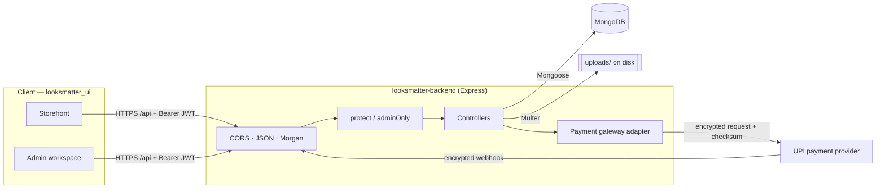

This is a **modular monolith**: one Express process, one MongoDB database, and clear internal layers. The server connects to MongoDB **before** it starts listening, so it never accepts traffic it can't serve. It also closes cleanly on `SIGINT`/`SIGTERM`.

### Request pipeline

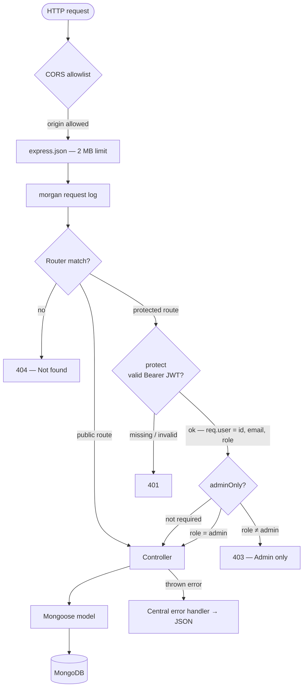

### Layers

| Layer | Folder | Responsibility |
| --- | --- | --- |
| Bootstrap | `src/server.js` | Middleware, route mounting, 404 + error handlers, startup, graceful shutdown |
| Routing | `src/routes/` | URL → middleware chain → controller; static routes declared before `/:id` routes |
| Access control | `src/middleware/auth.js` | `protect` verifies the JWT; `adminOnly` checks the role claim |
| Domain logic | `src/controllers/` | Validation, business rules, response shaping |
| Persistence | `src/models/` | Schemas, enums, indexes, hooks (password hashing, order numbers) |
| Shared helpers | `src/utils/` | Live-product resolution, quantity parsing, JWT signing, payment adapter |

---

## Data model

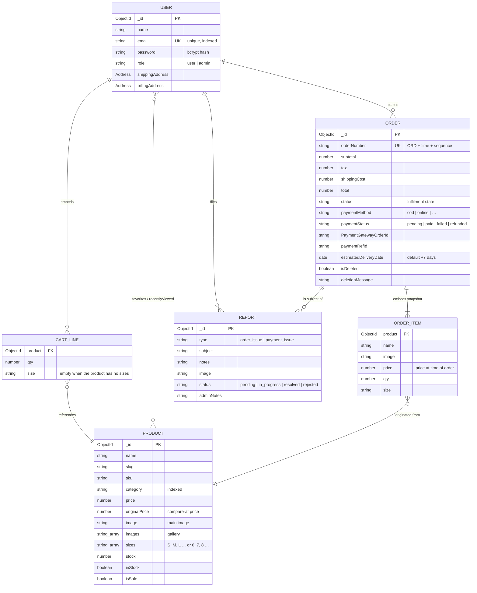

**Embed or reference?**

- **Cart lines are embedded in the user.** A cart is always read and written with its owner, and nothing else queries it.
- **Order items are embedded snapshots.** They keep a `product` reference for traceability, but name, image, and price are copied when the order is placed. History stays accurate after catalog edits.
- **Orders and reports are their own collections.** They have independent lifecycles and are queried across users by admins.

**Indexes:** `User.email` (unique), `Product.category`, `Order.orderNumber` (unique), `Report { user, status }`, `Report.order`.

---

## Core flows

### 1. Authentication and authorization

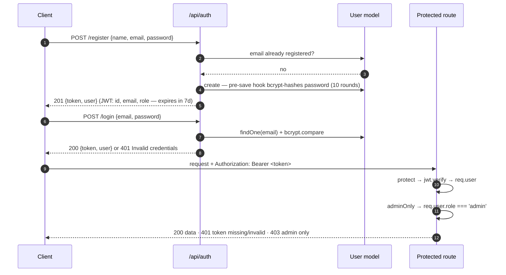

- Login returns the same message for an unknown email and a wrong password, so the endpoint can't be used to discover accounts.
- Password hashes are never returned. Profile queries use `.select('-password')`.
- **Password change** shares the profile route. When `PUT /api/users/me` includes `currentPassword` and `newPassword`, the server verifies the current password and enforces an 8-character minimum before rehashing.

### 2. Size-aware, self-healing carts

A cart line is identified by **product id + size**, so adding "Oxford Shirt / M" twice increments one line, while "Oxford Shirt / L" becomes a second line.

Carts, favorites, and recently viewed lists store product ids. Those ids can go stale when an admin deletes or re-imports a product. Every read therefore resolves the ids against the live catalog through one shared helper (`utils/cart.js`):

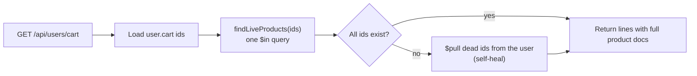

Writes are guarded as well. `addToCart` and `addFavorite` reject ids for products that don't exist. Quantities must be whole numbers ≥ 1. Add and remove are separate idempotent endpoints rather than a toggle, so a retried request can never flip state the wrong way.

### 3. Server-priced checkout

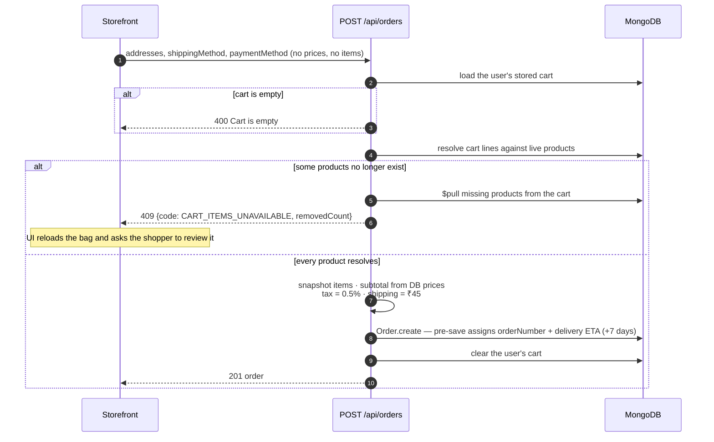

The request body has **no say in what is purchased or what it costs**. Items come from the server-side cart, and prices come from the product collection.

Error handling separates the two kinds of failure. Mongoose `ValidationError`/`CastError` become `400` with a useful message. Anything else is logged and returned as a generic `500`, so internal details are never shown to shoppers.

### 4. UPI payments

The payment adapter (`utils/paymentGateway.js`) wraps a UPI provider whose API exchanges **encrypted** payloads:

- **Encryption:** AES-256-CBC with a SHA-256-derived key and PKCS7 padding
- **Integrity:** HMAC-SHA256 checksum over the encrypted body
- **Credentials:** `client-id` and `secret-key` headers, read only from server environment variables

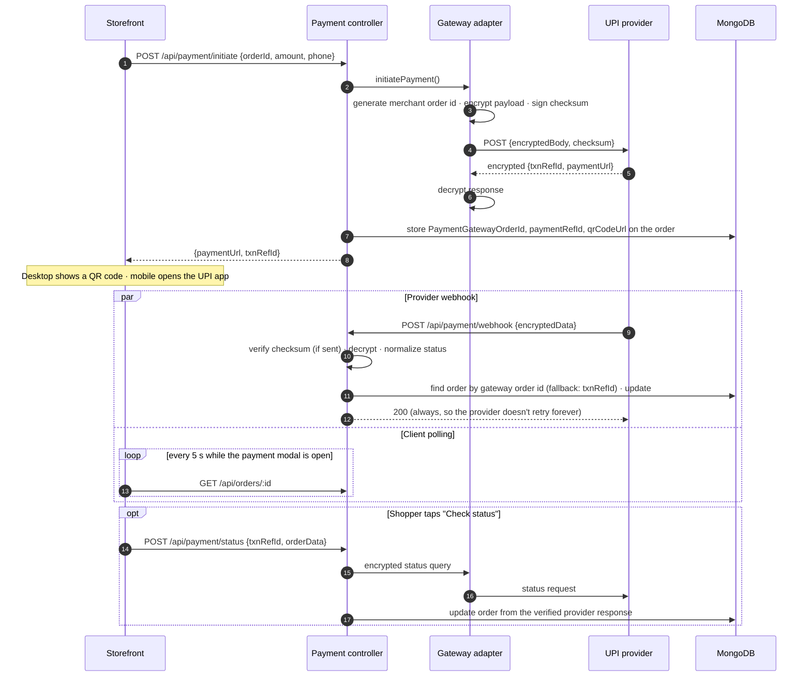

**Status normalization.** The provider returns statuses in several spellings. They are uppercased, stripped of underscores, and mapped to a small internal set:

| Provider status (normalized) | `paymentStatus` | Order `status` |
| --- | --- | --- |
| `SUCCESS` | `paid` | `order confirmed` |
| `FAILED`, `FAILURE` | `failed` | unchanged |
| `TAMPERED` (amount mismatch) | `failed` | `cancelled` |
| `REFUNDED`, `CBREFUNDED` (chargeback) | `refunded` | unchanged |
| `INITIATED`, `PENDING`, `TRANSACTIONINPROGRESS` | `pending` | unchanged |
| `HOLD`, `ONHOLD` | `pending` | unchanged |
| anything else | unchanged — logged for investigation | unchanged |

Two independent confirmation paths (webhook + polling/manual check) mean a missed webhook doesn't leave a paid order stuck in `pending`.

### 5. Order and payment lifecycles

Fulfilment (`status`) and money (`paymentStatus`) are separate fields, so each can be tracked independently.

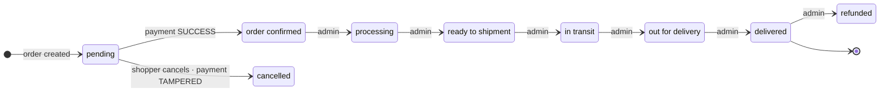

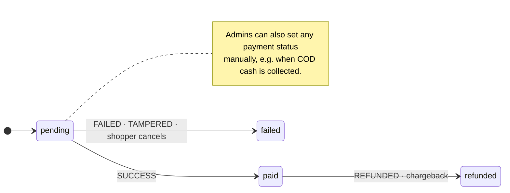

- A shopper can cancel **only while the payment is still `pending`**. Cancelling sets `status: cancelled` and `paymentStatus: failed`.
- Each order gets a human-readable **order number** (`ORD` + time component + sequence) and a default **estimated delivery date** 7 days out, both from a `pre('save')` hook. Admins can change the delivery date.

### 6. Store operations

**Bulk catalog import:** `POST /api/products/bulk`

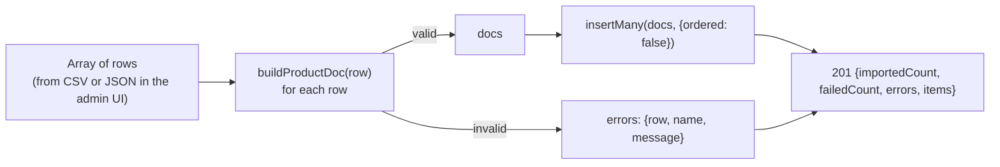

The normalizer is forgiving about input and strict about output. It is shared by single create, bulk import, and update.

- `"S, M, L"`, `"6|7|8"`, or `["S","M"]` → a deduplicated `sizes` array
- `"https://a.jpg, https://b.jpg"` → `image` (first URL) + `images` gallery. Commas inside a URL's query string (`?w=500,h=500`) are glued back together instead of splitting the URL.
- `"yes"`, `"In Stock"`, `"1"`, `true` → `inStock: true`
- Missing `slug` → generated from the name; missing `sku` → `CATEGORY-XXXX`
- `oldPrice` and `originalPrice` are kept in sync so the storefront strike-through price is always correct
- Required fields (`name`, `category`, `price`, `image`) are validated with a message that names exactly what is missing

**Partial updates:** `PUT /api/products/:id` only overwrites fields present in the request, so the admin form can send a subset. Explicit `false` values still apply.

**Product delete cascade:**

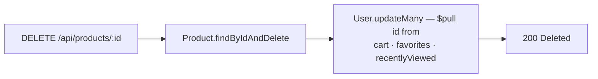

**Two-phase order removal:**

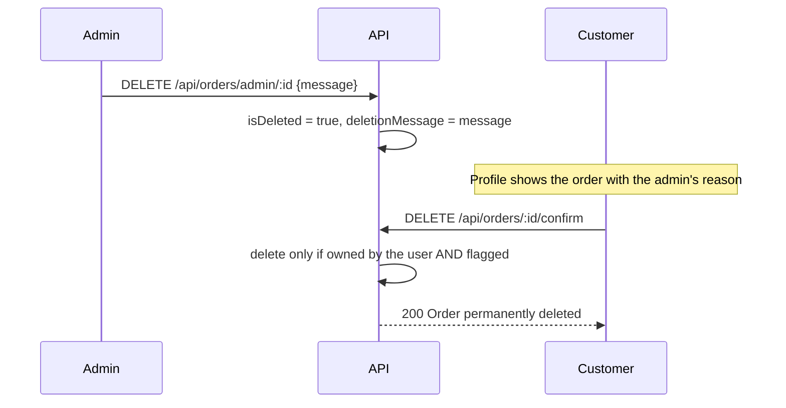

**Customer insights:** `GET /api/users/:id/orders` returns total, successful, pending, and cancelled order counts and lifetime spend (paid orders only), plus the 10 most recent orders.

### 7. Customer support reports

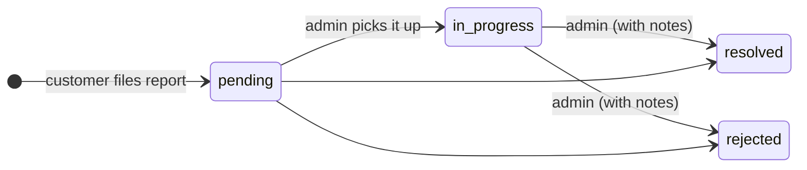

- A report must reference an order **owned by the reporter** (`order_issue` or `payment_issue`) and can carry a screenshot uploaded through `/api/uploads`.
- Admins filter by status and type and see aggregate counts from `GET /api/reports/admin/stats` (MongoDB `$group` by status and by type).
- `GET /api/reports/:id` is available to the report's owner and to admins.

---

## API reference

All routes are prefixed with `/api`. Protected routes need `Authorization: Bearer <token>`.
🌐 public · 🔒 signed-in user · 🛡️ admin · 🔁 provider callback

### Auth

| Method | Path | Access | Description |
| --- | --- | --- | --- |
| POST | `/auth/register` | 🌐 | Create an account → `{ token, user }` |
| POST | `/auth/login` | 🌐 | Sign in → `{ token, user }` |
| GET | `/auth/me` | 🔒 | Current user (without password) |

### Catalog

| Method | Path | Access | Description |
| --- | --- | --- | --- |
| GET | `/products` | 🌐 | List/search. Query: `q`, `category`, `page`, `limit` (default 20, max 100, `0` = all) → `{ items, total, page, pages }` |
| GET | `/products/:id` | 🌐 | Single product (`404` for malformed or unknown ids) |
| POST | `/products` | 🛡️ | Create one product |
| POST | `/products/bulk` | 🛡️ | Bulk import, partial success → `{ importedCount, failedCount, errors, items }` |
| PUT | `/products/:id` | 🛡️ | Partial update |
| DELETE | `/products/:id` | 🛡️ | Delete + cascade cleanup from all users |

`q` matches case-insensitively against name, description, and tags.

### Profile, cart, favorites, history

| Method | Path | Access | Description |
| --- | --- | --- | --- |
| GET | `/users/me` | 🔒 | Profile with addresses |
| PUT | `/users/me` | 🔒 | Update name/addresses; add `currentPassword` + `newPassword` to change the password |
| GET | `/users/cart` | 🔒 | Cart lines with full products (stale ids pruned) |
| POST | `/users/cart` | 🔒 | Add `{ productId, qty, size }`; merges into an existing product+size line |
| PUT | `/users/cart/:productId` | 🔒 | Set quantity `{ qty, size }` |
| DELETE | `/users/cart/:productId?size=M` | 🔒 | Remove one line |
| DELETE | `/users/cart` | 🔒 | Clear the cart |
| GET | `/users/favorites` | 🔒 | Favorite products (stale ids pruned) |
| POST · DELETE | `/users/favorites/:productId` | 🔒 | Idempotent add / remove |
| GET | `/users/recently` | 🔒 | Recently viewed products |
| POST | `/users/recently/:productId` | 🔒 | Record a view (most recent first, capped at 20) |

### Orders

| Method | Path | Access | Description |
| --- | --- | --- | --- |
| POST | `/orders` | 🔒 | Place an order from the server-side cart |
| GET | `/orders/my` | 🔒 | Current user's orders, newest first |
| GET | `/orders/:id` | 🔒 | One order (owner only) |
| PUT | `/orders/:id/cancel` | 🔒 | Cancel while payment is `pending` |
| DELETE | `/orders/:id/confirm` | 🔒 | Permanently delete an order the admin has flagged |
| GET | `/orders/admin/all` | 🛡️ | All orders with customer name/email |
| PUT | `/orders/admin/:id/status` | 🛡️ | Set fulfilment status |
| PUT | `/orders/admin/:id/delivery-date` | 🛡️ | Set estimated delivery date |
| PUT | `/orders/admin/:id/payment-status` | 🛡️ | Set payment status (validated enum) |
| DELETE | `/orders/admin/:id` | 🛡️ | Flag for deletion with a required `message` |

### Payments

| Method | Path | Access | Description |
| --- | --- | --- | --- |
| POST | `/payment/initiate` | 🔒 | Start a UPI payment → `{ paymentUrl, txnRefId, PaymentGatewayOrderId }` |
| POST | `/payment/status` | 🔒 | Ask the provider for a transaction's status and update the order |
| PUT | `/payment/update-order/:orderId` | 🔒 | Attach payment references to an owned order |
| POST | `/payment/webhook` | 🔁 | Encrypted provider callback |
| POST | `/payment/webhook/looksmatter` | 🔁 | Store-specific callback alias |

### Support reports

| Method | Path | Access | Description |
| --- | --- | --- | --- |
| POST | `/reports` | 🔒 | File `{ orderId, type, subject, notes, image? }` for an owned order |
| GET | `/reports/my` | 🔒 | Current user's reports |
| GET | `/reports/:id` | 🔒 / 🛡️ | One report (owner or admin) |
| GET | `/reports/admin/all` | 🛡️ | All reports. Query: `status`, `type` |
| GET | `/reports/admin/stats` | 🛡️ | `{ byStatus, byType }` counts |
| PUT | `/reports/admin/:id/status` | 🛡️ | `{ status, adminNotes? }` |

### Admin: customers and uploads

| Method | Path | Access | Description |
| --- | --- | --- | --- |
| GET | `/users` | 🛡️ | Customers, newest first (up to 500) |
| GET | `/users/:id` | 🛡️ | One customer |
| GET | `/users/:id/orders` | 🛡️ | Order statistics + 10 most recent orders |
| POST | `/uploads` | 🛡️ | `multipart/form-data`, field `image` → `{ url: "/uploads/<file>" }` |

Uploaded files are served statically from `/uploads/<file>`.

<details>
<summary><strong>Example requests</strong></summary>

```http
POST /api/auth/login
Content-Type: application/json

{ "email": "shopper@example.com", "password": "••••••••" }
```

```http
POST /api/users/cart
Authorization: Bearer <token>
Content-Type: application/json

{ "productId": "665f1c2e8a1b2c3d4e5f6a7b", "qty": 2, "size": "M" }
```

```http
POST /api/orders
Authorization: Bearer <token>
Content-Type: application/json

{
  "shippingAddress": {
    "country": "India", "firstName": "Asha", "lastName": "K",
    "address1": "12, 2nd Cross", "address2": "MG Road",
    "city": "Bengaluru", "state": "Karnataka", "pin": "560001", "phone": "9876543210"
  },
  "paymentMethod": "cod"
}
```

Checkout conflict response:

```json
{
  "code": "CART_ITEMS_UNAVAILABLE",
  "removedCount": 1,
  "message": "Some items in your bag are no longer available and have been removed. Please review your bag and place the order again."
}
```

</details>

---

## Getting started

### Prerequisites

- **Node.js 18+** (the payment adapter uses the built-in `fetch`)
- **npm**
- **MongoDB**: a local instance or a MongoDB Atlas cluster

### Install and run

```sh
git clone https://github.com/abuiron/looksmatter_bc.git looksmatter-backend
cd looksmatter-backend
npm ci
cp .env.example .env        # then edit the values
npm run dev                 # nodemon, restarts on change
```

Check that it is running:

```sh
curl http://localhost:5000/                 # → API running successfully
curl "http://localhost:5000/api/products?limit=5"
```

| Script | What it does |
| --- | --- |
| `npm run dev` | Start with Nodemon (auto-reload) |
| `npm start` | Start with Node (production) |
| `npm run seed` | **Destructive** development seed — see below |

### Optional: seed a development database

> ⚠️ **`npm run seed` deletes every product and user** in the configured database. Point it only at a disposable development database.

The seed creates an admin from `ADMIN_EMAIL` / `ADMIN_PASSWORD`, plus a sample shopper (`user@example.com`). It imports the catalog from the storefront repo, which must be checked out next to this one:

```text
parent/
├── looksmatter-backend/          ← this repo
└── looksmatter_ui/
    └── src/data/products.json    ← seed catalog
```

### Run the full stack locally

1. Start this API on `http://localhost:5000`.
2. In `looksmatter_ui`, set `VITE_API_BASE_URL=http://localhost:5000/api` in `.env.local` and run `npm run dev`.
3. Open `http://localhost:5173`. That origin is already in the CORS allowlist.

---

## Configuration

All configuration comes from environment variables. See [`.env.example`](.env.example).

| Variable | Required | Purpose |
| --- | --- | --- |
| `MONGO_URI` | ✅ | MongoDB connection string |
| `MONGO_DB` | ✅ | Database name |
| `JWT_SECRET` | ✅ | Secret used to sign and verify JWTs |
| `PORT` | — | HTTP port (default `5000`) |
| `ADMIN_EMAIL`, `ADMIN_PASSWORD` | seed only | Admin account created by `npm run seed` |
| `PaymentGateway_CLIENT_ID` | payments | Provider client id |
| `PaymentGateway_SECRET_KEY` | payments | Provider secret |
| `PaymentGateway_ENCRYPTION_KEY` | payments | Key for AES payloads and HMAC checksums |
| `PaymentGateway_API_URL` | payments | Payment initiation endpoint |
| `PaymentGateway_STATUS_API_URL` | payments | Transaction status endpoint |
| `PaymentGateway_CALLBACK_URL` | payments | Public webhook URL registered with the provider |

**CORS:** allowed origins are listed in [`src/server.js`](src/server.js) (`localhost:5173` plus the production storefront domains). Add your origin there when deploying the UI elsewhere.

Payment secrets live **only** in the backend environment. The storefront never sees them.

---

## Project structure

```text
looksmatter-backend/
├── src/
│   ├── server.js                 # App bootstrap, middleware, routes, errors, graceful shutdown
│   ├── config/
│   │   └── db.js                 # MongoDB connection (fails fast with a clear message)
│   ├── middleware/
│   │   └── auth.js               # protect (JWT) · adminOnly (role)
│   ├── routes/                   # auth · products · users · orders · payment · reports · upload
│   ├── controllers/
│   │   ├── authController.js     # register · login · me
│   │   ├── productController.js  # list/search · CRUD · bulk import · input normalizers
│   │   ├── userController.js     # profile · cart · favorites · history · admin customer views
│   │   ├── orderController.js    # checkout · lifecycle · cancellation · two-phase delete
│   │   ├── paymentController.js  # initiate · status check · webhook · status mapping
│   │   └── reportController.js   # support reports · admin workflow · stats
│   ├── models/                   # User · Product · Order · Report
│   ├── utils/
│   │   ├── cart.js               # live-product resolution, ObjectId + quantity guards
│   │   ├── paymentGateway.js     # AES-256-CBC / HMAC-SHA256 provider adapter
│   │   └── token.js              # JWT signing (7-day expiry)
│   └── seed/
│       └── seed.js               # development seed (destructive)
├── uploads/                      # runtime image uploads (git-ignored, except .gitkeep)
├── .env.example
└── package.json
```

---

## Engineering conventions

**Consistent error responses.** Every error is JSON with a `message`, plus a machine-readable `code` where the client needs to branch on it.

| Status | Meaning in this API |
| --- | --- |
| `400` | Invalid input: malformed ObjectId, missing fields, bad enum value, quantity < 1 |
| `401` | Missing or invalid token, wrong credentials |
| `403` | Signed in, but not allowed (admin only, someone else's resource) |
| `404` | Unknown route or resource, or a product that no longer exists |
| `409` | Conflict: email already registered, or `CART_ITEMS_UNAVAILABLE` at checkout |
| `500` | Unexpected server error. Logged in full, returned as a generic message |

**Ownership checks in the query.** User-scoped reads and writes filter by both id and owner (`Order.findOne({ _id, user: req.user.id })`). Another user's order returns `404`, not `403`, which avoids revealing that it exists.

**ObjectId validation first.** Ids are validated before they reach Mongoose, so a malformed URL returns a clean `400`/`404` instead of a `CastError` stack trace.

**Route ordering.** Static segments (`/admin/all`, `/bulk`, `/my`) are declared before `/:id` routes so they are never captured as ids.

---

## Known limitations and roadmap

This project is under active development. These are the next engineering steps, listed openly:

- **Checkout atomicity.** Order creation and cart clearing are two writes. Wrap them in a MongoDB transaction and add an idempotency key so a double-submitted checkout creates one order.
- **Inventory.** `stock`/`inStock` are catalog fields; checkout does not yet reserve or decrement stock atomically.
- **Payment hardening.** Reconcile the provider-reported amount and merchant order id against the stored order on every status update. Enforce ownership on status checks. Deduplicate webhook events. Retire the client-driven `update-order` route in favour of provider-verified updates only.
- **State machine enforcement.** Admin status updates accept any status. Validate allowed transitions and run schema validators on updates.
- **Token lifecycle.** Roles are embedded in 7-day JWTs. Add refresh tokens and revocation so role changes take effect immediately.
- **Uploads.** Files live on local disk. Move to object storage (S3 / Cloudinary) with MIME-type and size validation for multi-instance deployments.
- **Search at scale.** Regex search suits the current catalog size. Add a text index or a search service as the catalog grows.
- **Validation layer.** `express-validator` is installed. Adopt it consistently for request schemas.
- **Automated tests.** Add API tests (Jest + Supertest + mongodb-memory-server) for checkout conflicts, ownership boundaries, admin-only routes, bulk import, and payment status mapping.
- **Operations.** Add rate limiting on auth routes, `helmet` security headers, structured logging, and an OpenAPI specification.

---

## Related

- **Storefront and admin UI:** [abuiron/looksmatter_ui](https://github.com/abuiron/looksmatter_ui)
